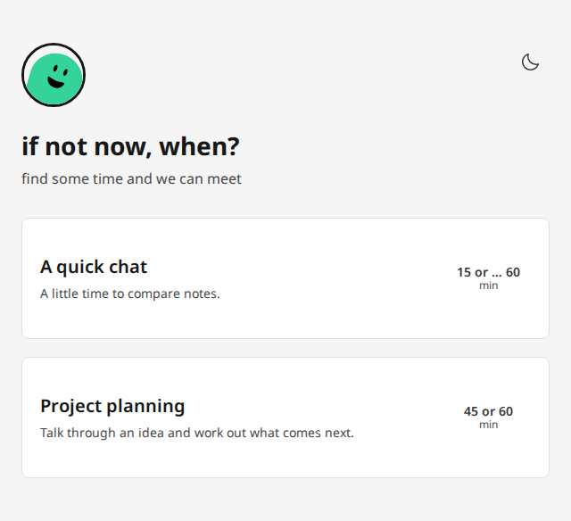

# 📅 When

Appointment scheduling for one person. You, probably.



[More screenshots](docs/screenshots.md).

A public booking page, an admin UI, Google and CalDAV calendars, and email
notifications. Configure it in YAML. Keep your appointments in SQLite.

No teams. No round-robin routing. No subscription to your own calendar.

## Get started

You'll need Docker Compose 2.24 or newer. In a fresh directory:

```sh
mkdir when
cd when
mkdir config data public
curl -fsSLo compose.yaml https://git.eleith.com/eleith/when/raw/branch/main/docs/compose.yaml
curl -fsSLo config/when.yaml https://git.eleith.com/eleith/when/raw/branch/main/docs/when.example.yaml
chmod 600 config/when.yaml
```

Edit `config/when.yaml`: your public HTTPS URL (`url.app`), admin password,
owner details, SMTP account and calendar. No `.env` file is required.

Put a trusted reverse proxy in front of When; see the
[proxy requirements](docs/deployment.md#reverse-proxy). Keep your config private
and readable by container UID 1000; make `data/` writable by that UID. See
[permissions](docs/deployment.md#start-up).

```sh
docker compose up -d
```

Open your public proxy URL and its `/admin` page to get a lay of the land.
Optional environment interpolation, port overrides and persistent sessions are
covered in [deployment](docs/deployment.md#environment-variables).

There is a lot more going on under the hood, read more documentation if you
want to learn more.

## Documentation

- [Configuration](docs/config.md) — fields, defaults and examples.
- [Deployment](docs/deployment.md) — run it, update it, recover it.
- [Development](docs/development.md) — change it without making a hobby of it.
- [Philosophy](docs/philosophy.md) — what belongs here. And what doesn't.
- [Architecture](docs/architecture.md) — where the pieces live.
