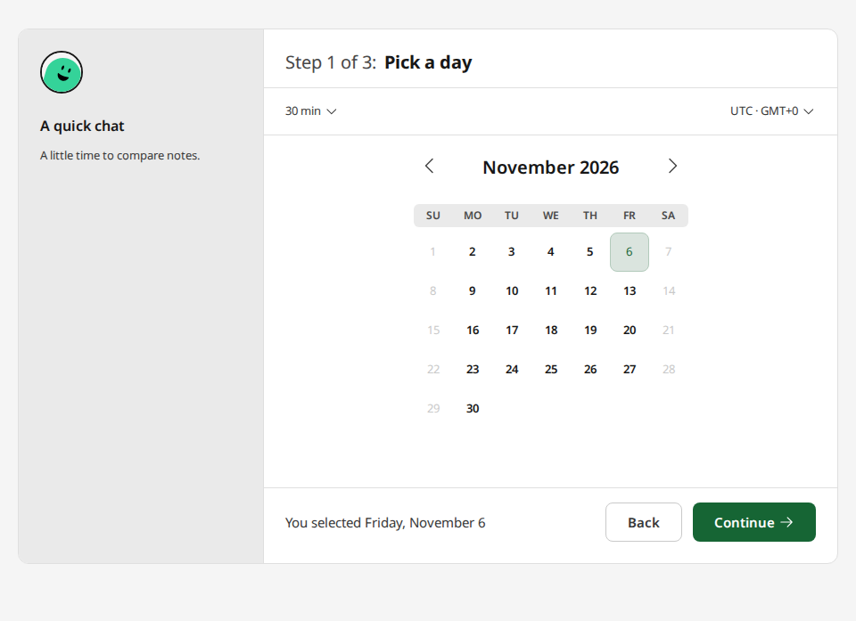
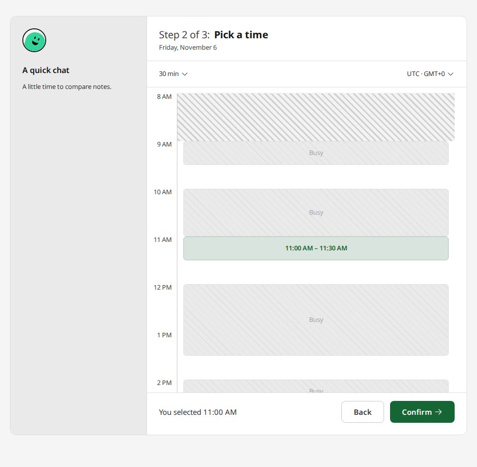
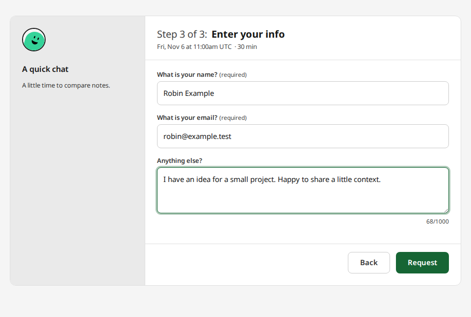
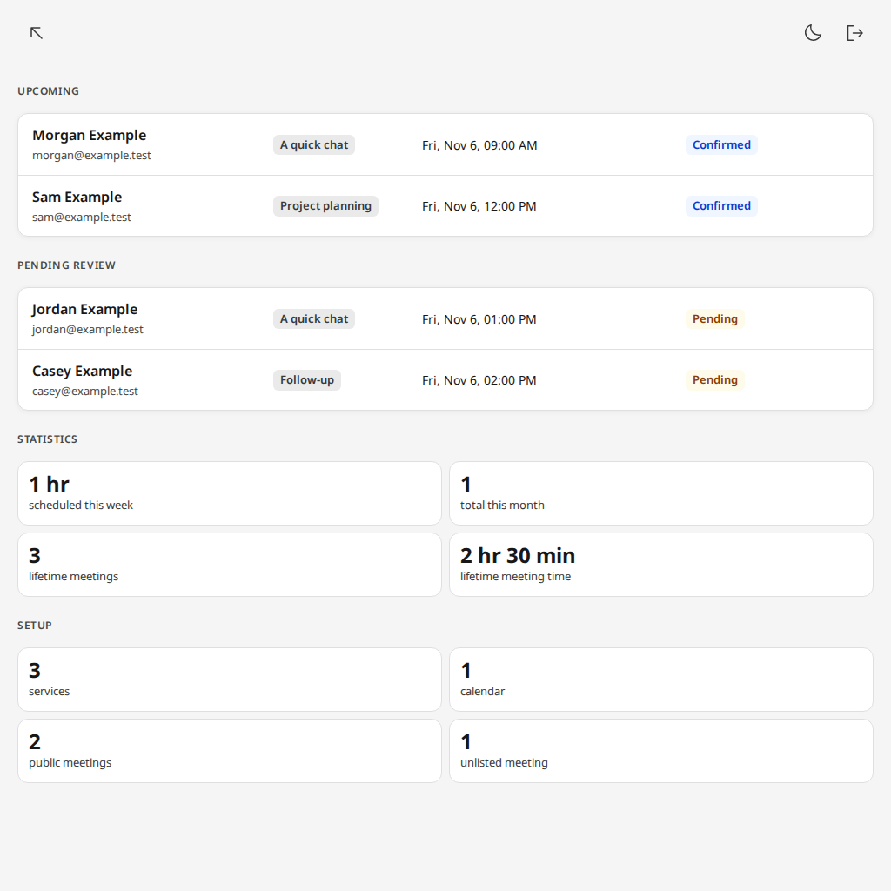

# Screenshots

One example setup. Fictional people and appointments.

## Pick a day

The calendar shows the days that fit the selected length.

## Pick a time

Pick a time around busy periods. The selected slot is highlighted.

## Request a meeting

This meeting requires approval: the guest sends a request rather than booking
instantly.

## Manage appointments

Upcoming appointments, requests awaiting review, and a few totals.

